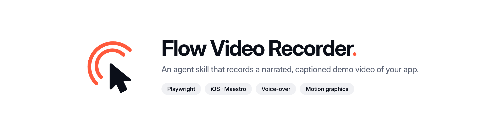

<p align="center">
  <picture>
    <source media="(prefers-color-scheme: dark)" srcset=".github/brand/banner-dark.png">
    
  </picture>
</p>

<p align="center">
  <a href="https://skills.sh/muayadjamal/flow-video-recorder"></a>
  <a href="https://github.com/muayadjamal/flow-video-recorder/actions/workflows/validate.yml"></a>
  <a href="LICENSE"></a>
</p>

An agent skill that records a narrated demo video of your app. Tell Claude Code (or Codex, Cursor, any agent that reads `SKILL.md`) which flow to show, and it writes a script, drives the app, and hands back an MP4 with a moving cursor, a ripple on every click, a caption per step, and a voice that explains what is happening while it happens.

It works on two surfaces:

| | Browser | Native iOS |
|---|---|---|
| Driver | Playwright | Maestro on the simulator |
| Capture | Playwright `recordVideo` | `simctl io recordVideo` |
| Cursor, ripple, captions | injected into the page | composited after capture |
| Output | 2560x1440 MP4, supersampled | device-resolution MP4 |

Narration can come from ElevenLabs, OpenAI, the macOS `say` command, or any local model you can call from a shell line (Piper, Kokoro, a TTS server). With no engine configured the same flow records silently with captions.

## See it working

Every video on [edumind.school/course](https://edumind.school/course?lang=en) was made with this skill: 20 walkthroughs of a school management platform, about 41 minutes in total, in English and Arabic, covering both the web app and the native parent and teacher apps. A few direct links:

- [Meet EduMind](https://edumind.school/course/01-overview/en.mp4) (web, with motion-graphics scenes)
- [The parent app](https://edumind.school/course/02-parent-app/en.mp4) (native iOS)
- [Exams: from question bank to paper](https://edumind.school/course/11-exams/en.mp4) (web)

## Install

Claude Code, as a plugin (updates itself). Two commands, run one after the other:

1. Add the marketplace:
   ```text
   /plugin marketplace add muayadjamal/flow-video-recorder
   ```
2. Install the plugin:
   ```text
   /plugin install flow-video-recorder@flow-video-recorder
   ```

Claude Code, Codex, Cursor and other agents, through [skills.sh](https://skills.sh/muayadjamal/flow-video-recorder) (copies the files so you can edit them):

```bash
npx skills add muayadjamal/flow-video-recorder                       # into this project
npx skills add muayadjamal/flow-video-recorder -g                    # for every project
npx skills add muayadjamal/flow-video-recorder -g -a claude-code     # one agent only
```

Codex, from inside a session:

```text
$skill-installer install https://github.com/muayadjamal/flow-video-recorder
```

By hand:

```bash
git clone https://github.com/muayadjamal/flow-video-recorder ~/.claude/skills/flow-video-recorder
```

## Requirements

- `node` 20 or newer and `ffmpeg` on the PATH.
- Browser flows: `playwright` in the target project (`npm i -D playwright && npx playwright install chromium`).
- iOS flows: macOS with Xcode, a booted simulator with your app installed, and [Maestro](https://maestro.mobile.dev) at `~/.maestro/bin/maestro`.
- Narration, optional: `ELEVENLABS_API_KEY` or `OPENAI_API_KEY` in the environment or the project's `.env`, or `TTS_COMMAND` for your own engine. On macOS `say` works with nothing set.

## Usage

Ask for a video in plain language:

> Record a demo video of the checkout flow, with narration.

The skill first asks what goes in the video (voice-over, subtitles, pointer, motion graphics), checks the tools above, copies its helper scripts into the project, writes a flow file for your app, and runs one of:

```bash
ELEVENLABS_API_KEY=… BASE=http://localhost:8000 bash <skill>/assets/record.sh flow.mjs demo.mp4
ELEVENLABS_API_KEY=… UDID=<simulator> bash <skill>/assets/record-ios.sh flow.mjs demo.mp4
```

A flow file is a short JavaScript module. Each step says its line, does its clicking, and holds until the line is finished:

```js
export const narration = [
  { id: 'open', caption: 'Open the order', text: 'Start from the orders list and open the one that just arrived.' },
];

export default async ({ page, say, hold, click, goto }) => {
  await goto('http://localhost:8000/orders');
  say('open');
  await click(page.getByRole('link', { name: 'ORD-1042' }));
  await hold();
};
```

Narration engine, picked automatically from the environment or forced with `TTS_PROVIDER`:

| Provider | Needs |
|---|---|
| `elevenlabs` | `ELEVENLABS_API_KEY` |
| `openai` | `OPENAI_API_KEY` |
| `say` | macOS |
| `command` | `TTS_COMMAND`, a shell line that reads `$TTS_TEXT` and writes `$TTS_OUT` |

Any local model (Piper, Kokoro, a TTS server you run) plugs in through `command`:

```bash
TTS_COMMAND='piper --model en_US-lessac-medium.onnx --output_file "$TTS_OUT" <<< "$TTS_TEXT"' \
  bash <skill>/assets/record.sh flow.mjs demo.mp4
```

Opt-in extra for browser flows: mark the clicks that matter with `click(…, { zoom: true })`, then run `assets/frame.sh` to render spring-eased push-ins inside a framed canvas (background, rounded corners, shadow). It uses Remotion, installed on first use only, so the default pipeline stays light.

After every run the recorder prints a table of spoken length against on-screen length per step, and flags silence and lines that kept talking after the screen changed.

## How it works

The picture is paced to the audio rather than the other way round. Every narration clip is synthesized and measured before the app opens, so a step lasts exactly as long as its sentence, and the voice never gets cut off by the next screen. Fitting audio to an already recorded video fails because step durations vary from run to run.

On iOS there is no DOM to inject into and Maestro runs a static YAML, so the flow is executed twice: once to plan, once for real, with Maestro calling back into the recorder over HTTP before every tap. The cursor, ripples and captions are painted on afterwards from the tap log. A frame-difference check then confirms each line stayed on the screen it describes.

Motion graphics are optional HTML scenes animated with GSAP, rendered frame by frame and cut in between recorded steps with a transition on each side. The assembler measures loudness around every join and refuses to ship a video where speech falls under a cut.

The full method, every environment knob, and the gotchas are in [SKILL.md](SKILL.md).

## Files

| File | Does |
|---|---|
| `SKILL.md` | The instructions the agent follows |
| `assets/record.sh`, `assets/recorder.mjs` | Browser entry point and Playwright driver |
| `assets/record-ios.sh`, `assets/ios-recorder.mjs`, `assets/ios-compose.mjs` | iOS entry point, Maestro driver, overlay compositor |
| `assets/tts.mjs`, `assets/mux.mjs` | Narration through ElevenLabs, OpenAI, macOS say or a custom command, with caching; audio muxing |
| `assets/motion.mjs`, `assets/assemble.mjs`, `assets/kit.js`, `assets/preview.mjs` | Motion-graphics renderer, assembler, scene helpers, preview |
| `assets/frame.sh`, `assets/frame/` | Optional Remotion render: zoom push-ins inside a framed canvas |
| `assets/*.example.*` | A browser flow, an iOS flow, two scenes and a plan to copy from |
| `assets/ios-calibrate.mjs` | Measures capture clock drift on a simulator |

## Support

- A recording failed or came out wrong: [open a bug report](https://github.com/muayadjamal/flow-video-recorder/issues/new?template=bug.yml) with the command you ran and the recorder's output.
- Something it should do and does not: [request a feature](https://github.com/muayadjamal/flow-video-recorder/issues/new?template=feature.yml).
- A question, or a video you made with it: [Discussions](https://github.com/muayadjamal/flow-video-recorder/discussions).
- A security problem: see [SECURITY.md](.github/SECURITY.md).

Pull requests are welcome. [CONTRIBUTING.md](CONTRIBUTING.md) has the layout, the checks to run, and the versioning rule.

## License

MIT. See [LICENSE](LICENSE).
